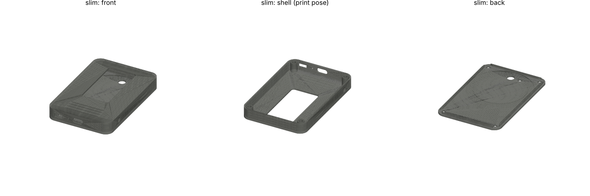
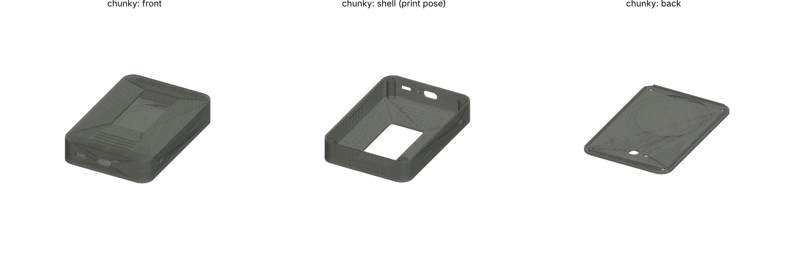
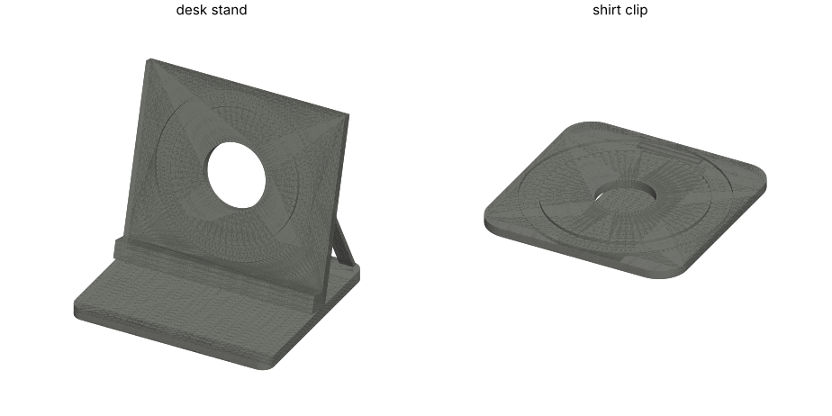

# Printable case

Four case variants and two accessories, generated by `generate.py` (Python + manifold3d).
Ready-to-print STLs and previews are in [`stl/`](stl/).

**Measure your parts before printing.** Every dimension below is an estimate. Check your battery
thickness, the XIAO + Sense stack height, the USB-C port height, and your phone's camera-bump
clearance with calipers, then change the numbers in `VARIANTS` and run `python3 generate.py`.

| Variant | Size (mm) | Best for | Notes |
| --- | --- | --- | --- |
| `slim` | 58 × 88 × 11 | **Main design** | Landscape use, camera + LDR on the back inside the MagSafe ring, REC dimple and MODE groove on the edge, grip lines. Needs a ~4 mm flat LiPo and the camera moved off the Sense board on a flex extension. |
| `pebble` | 58 × 88 × 11 | Same internals, softer look | 13 mm corner radius and a chamfered front edge. |
| `thin` | 58 × 88 × 9.5 | No-camera build | For the plain XIAO ESP32S3 + small mic board (no Sense board). No camera or LDR holes. |
| `chunky` | 64 × 94 × 17 | **Print this first** | Fits today's parts unmodified: XIAO + Sense with the camera attached, 1300 mAh cell up to 10 mm. Side vents. Camera hole at the bottom of the back. |
| `desk_stand` | 70 × 64 × 66 | Lectures | Holds the recorder sideways at 15°, screen to you, camera to the slides. Stick a steel ring (55/45 mm) in the recess; the centre is open for the camera. |
| `shirt_clip` | 58 × 58 × 6 | Wearing it | Clips to a pocket, collar or lanyard; the recorder snaps on with its MagSafe ring. |

## Print settings

- **Material:** PETG (or ASA). Not PLA: it softens around 55–60 °C, which a pocket or a car in Singapore reaches.
- **Layer height** 0.16 mm; **walls** 3 perimeters; **infill** 30% gyroid; no supports needed.
- **Orientation:** the STLs are already posed. The shell prints front-face down (smooth screen side), the back prints outside-face down (flat MagSafe face).
- **Clip:** 100% infill for the spring tongue, or it will crack.

## Hardware

| Part | Qty |
| --- | --- |
| M2 heat-set inserts, 3.2 mm OD × 4 mm | 4 per case |
| M2 × 4 mm flat-head screws | 4 per case |
| MagSafe **magnet** ring sticker with alignment tab (≈54–55 OD / 45–46 ID mm) | 1 per case |
| MagSafe **steel** ring sticker (≈55/45 mm, 0.55 mm) | 1 per stand / clip |
| Acoustic mesh dot (≈4 mm) behind the mic hole | 1 |
| Clear acrylic disc 8 mm (optional camera cover) | 1 |

## Assembly

1. Press the heat-set inserts into the four bosses with a soldering iron at about 220 °C.
2. Stick the copper-tape touch pads inside the right edge, behind the REC dimple and MODE groove. Solder a thin wire to each.
3. Fit the e-ink panel behind the window (a strip of Kapton or foam tape holds it).
4. Place the XIAO in the bottom zone with USB-C lined up to the slot, then the battery behind the screen.
5. Peel and stick the magnet ring into the back recess, tab pointing down, **after** testing which way it snaps to your phone.
6. Close with the four M2 screws.

## Checks before the full print

- Print only `slim_back.stl` first (≈15 min). Check the magnet hold, the tab alignment and the camera-bump clearance on your phone.
- Check the USB-C slot height against your board stack. Set `usb_z` if it's off.
- The REC dimple should be felt clearly but not catch on pockets.
